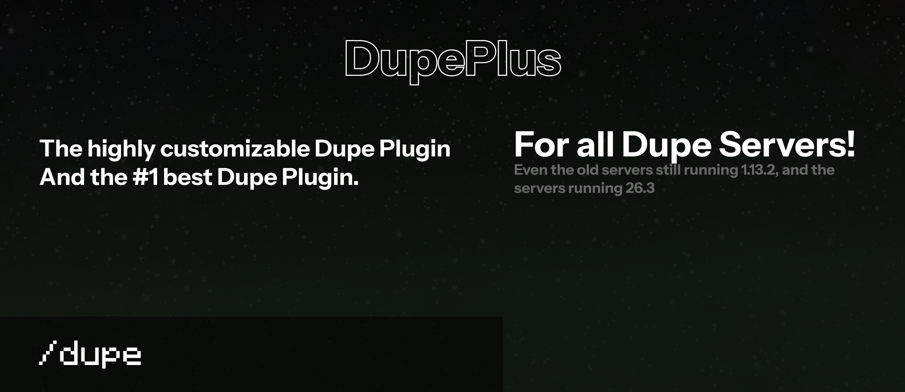

    
     
    
    

<h1 align="center">DupePlus</h1>

DupePlus is a highly modular SpigotMC/PaperMC plugin that supports Minecraft versions from 1.13.2 to 26.3 and beyond. It
introduces a chat command `/dupe`, which duplicates the item held by the player. Additionally, it offers various
features to customize your gameplay experience.

# 🔌 Installation

Download the plugin from the First Version in the Featured Versions or from the Versions Tab, next click Download and
upload it to the `/plugins` folder in your Minecraft Server Files.

# 🔧 Configuration

The config file will be in the `/plugins/DupePlus` folder located in your Minecraft Server files.

Previous config versions will be renamed to old.config.yml or deleted.

# 🎗️ Contributing
Everything about contributing is in its own dedicated Markdown file. You can find it here:

[Contributing.md](CONTRIBUTING.md)

# 🔨 Compiling

Requirements:

- Java JDK 11 or newer.

## 🛠️ Building the JAR

`./gradlew clean shadowJar`

# 🔗 Links

- [DupePlus Docs](http://galaxyy.gitbook.io/dupeplus)
- [DupePlus Discord server](https://discord.gg/hdMVQJ3XyN)

# 📜 License

DupePlus is licensed under the MIT License. You may
view [LICENSE](https://github.com/meme20200/dupeplus/blob/main/LICENSE) if you want to.